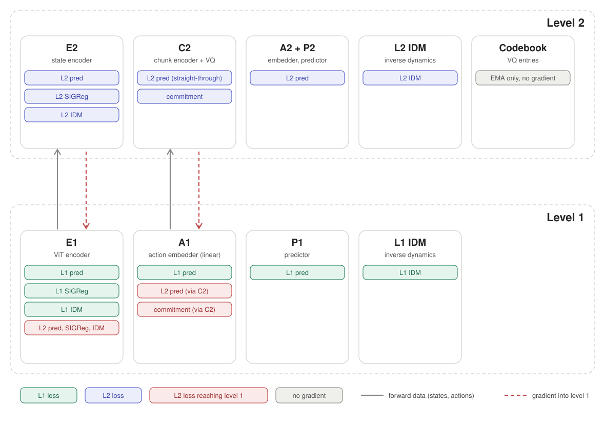

# Hierarchical JEPA World Models on Craftax-Classic

Learning hierarchical latent world models from pixels and planning with them all the way to **diamond**.

## Introduction

Planning with a learned world model gets harder as the goal gets further away. Prediction errors compound over long rollouts, and in the latent space of a flat model the distance to a far-away goal carries almost no signal about progress. H-JEPA ([Zhang, Terver et al., 2026](https://arxiv.org/abs/2610.06805)) addresses this with a stack of action-conditioned JEPA world models trained end-to-end. Each level predicts further ahead in its own learned latent space, and planning proceeds top-down: the top level optimises progress toward the goal, and its predictions become subgoals for the level below. The paper demonstrates this on continuous-control and manipulation tasks.

This project transfers H-JEPA to [Craftax-Classic](https://github.com/MichaelTMatthews/Craftax), a procedurally generated, discrete-action, long-horizon benchmark. Reaching diamond requires a long chain of dependent achievements (table, wood and stone pickaxes, furnace, coal, iron, iron pickaxe), which makes it a natural test for hierarchical planning. We compare H-JEPA against a flat world model (LeWM) and a shared-latent hierarchy (HWM), analyse what each level learns to represent, and study two extensions: levels that predict over a band of horizons instead of a fixed stride, and levels that learn their own time-independent jumps (in the spirit of THICK, Gumbsch et al., ICLR 2024).

## Research questions

| | Question |
|---|---|
| **RQ1** Hierarchy | How much does a hierarchy of learned latent spaces (H-JEPA) improve planning success over a flat world model and a shared-latent hierarchy (HWM) on Craftax-Classic, and how does this change with goal distance, up to diamond? |
| **RQ2** Representation | What information does each level of H-JEPA retain or discard, and how does this relate to the temporal frequency of the underlying entities? |
| **RQ3** Variable horizons | To what extent does letting each level predict over a band of horizons, with the planner choosing the horizon, improve planning over a fixed stride per level? |
| **RQ4** Learned jumps | Can a level learn time-independent, meaningful jumps from observation-action data alone, and how does planning with them compare to fixed and band strides? |

## Method

```
pixels o_t ──ViT, patch 7──► z1_t ──► predictor 1 ──► z1_t+1             level 1: step = 1 env step
                              │            ▲
                a_t, one-hot(17) ──────────┘
                              │ chunk of s latents
                              ▼
          z1_t..t+s ──latent MLP──► z2_T ──► predictor 2 ──► z2_T+1      level 2: step = s env steps
                                      │            ▲
  a_t..t+s ──sequence encoder──VQ──► token ────────┘         token = code indices [+ one-hot k]
```

- **Levels.** Level 1 encodes a 63×63 frame with a ViT (patch 7, one patch per tile). Each level above encodes one latent of the level below every `stride` steps (`window_size` 1; a window of several latents is possible): with a latent MLP in H-JEPA, with the identity in HWM (one shared latent space). Its actions are the pooled chunk of `stride` lower-level actions. LeWM is level 1 alone, the same code with `num_levels: 1`.
- **Predictor.** A causal transformer over a history of 3 latents, conditioned on the embedded action token, predicts the next latent.
- **Action tokens.** Level 1: one-hot of the 17 actions, embedded by one linear layer. Levels above: a sequence encoder pools the chunk of lower-level actions, and a factorized VQ codebook (2 groups of 64 codes) turns it into code indices. Optionally the token also carries the step duration k (band of horizons, E7).
- **Losses per level.** Next-latent MSE, SIGReg on the latents (not above level 1 in HWM), an inverse-dynamics cross-entropy (action index at level 1, code indices above), and the VQ commitment loss above level 1.
- **Planning.** Top-down CEM over the discrete tokens of every level, forward passes only. The top level minimises the latent distance to the goal frame, its predicted latents become the subgoals of the level below, and level 1 outputs environment actions (receding horizon).
- **Planner design.** Candidate tokens are always valid actions, but a chain of them can still leave the data support and the planner can exploit model errors there. The planner is still an open decision (trust regions, learned actors); for now the upper-level CEM mixes in code sequences of the training data. The diagnostics for it exist from the start (see Diagnostics): plans replayed in the simulator against the model's prediction and against random plans, success against planner compute (experiment C1), and the distance of predicted latents to the data.

## Setup

**Environment.** Craftax-Classic (JAX). World models use pixel observations. The symbolic state is used only by the expert and for probing and evaluation. Diamond is achievement 19 and requires the iron pickaxe.

**Expert.** PQN-RNN from [purejaxql](purejaxql), trained on `Craftax-Classic-Symbolic-v1`. Rolled-out episodes are filtered to the successful ones (diamond collected), and the collector renders pixels from the same state.

**Data.** Two classes of episodes, the mix counted in frames and not in episodes (placeholder 70 / 30, `collection.share` in `experiments.yaml`; every collector run stops at its share with `--target-frames`): the final expert's episodes that reach the diamond (`source 0`; the tasks come from them), and rollouts of earlier snapshots of the expert's training (`source 3`, `early`). The snapshots come from the chunked expert training and are chosen by their test metrics (achievements), spread over the stages of the diamond chain; the early share is split equally among them (`--early-checkpoint`, repeatable) and each frame records its snapshot in `policy_updates`. The early rollouts need no diamond, may die, and are coherent behaviour at every stage, unlike epsilon noise inside a chunk. They train every level. The test split holds only the final expert (its tasks). Uniform random (`source 2`, trains level 1 only: `upper_loss_exclude_sources: [2]`, a chunk of random actions is noise as a macro-action) and noised expert (`source 1`) stay as optional fallbacks (`collection.share`, default 0): add them only if the D0 action-coverage table shows actions that the early policies never take (the training batch carries the `source` column, and with fewer than two other clips in a batch all clips are used). The final mix is set after D0. Episodes that ended in death (`dead` flag) are extended in the training clips by copies of their dead frame (`data.dataset.terminal_pad: auto`, one top-level step minus one frame, at most span - 1), an absorbing state, so every level sees the death on its step grid; the padded steps have no action. Seeds are the split: training from 0, validation from 1,000,000, test from 2,000,000 (the final expert uses the first 500,000 seeds of each range, the other runs share the rest equally; every collector run stops with `--seed-end` where the next range begins, so a low diamond rate cannot run into another split). Exploration takes its tasks from the validation worlds, headline results (`--final`) from the test worlds. `experiments/run.py plan D1 --expert-checkpoint <ckpt> --early-checkpoint <snapshot> ...` prints the collection commands. We report a per-level clip count for each depth, to see early whether deeper levels still have enough data.

## Models

| Model | Hierarchy | Role |
|---|---|---|
| **LeWM** | Single level (JEPA + SIGReg) | Flat baseline |
| **HWM** | Several temporal levels, identity encoders above level 1, one shared latent space | Isolates temporal decomposition |
| **H-JEPA** | A distinct learned latent space per level, trained end-to-end | Main model |

## Evaluation

| Protocol | Definition | Metric |
|---|---|---|
| **A. Offset goals** | Start and goal frames from held-out expert trajectories, one task per world seed, only pairs with progress between start and goal (fixed offsets, or the d-th next achievement) | Success and progress under the goal test below, against a random policy on the same tasks |
| **B. Full episodes** | From reset to the frame where the expert unlocks the diamond in the same world seed, so the whole chain is required (the final goal only; key states are not built) | Diamond rate and the unlock rate of every required achievement (the planning report); success needs all required achievements, also incidental ones |

**Goal test.** A task's required set is the achievements the goal frame has and the start frame lacks. Success means all of them are unlocked, in any order and by any route; progress is the share unlocked. The planner never sees this: it minimises the latent distance to the goal frame (in the projected embedding space that the predictor and SIGReg use; between levels, predictions are encoded up to the upper latent). The test only judges the result. 

All achievements count, including those a random agent gets by itself (wake up, drink, sapling): the random baseline on the same tasks is the reference. Protocol A uses offsets with progress as its main task set, reported per offset. Every reported success number comes with the planner compute used. The planner is goal-conditioned and reward-free, so results are phrased as "reaches X% of the expert's achievement rate given goal frames", not "beats the expert".

## Experiments

| ID | RQ | Experiment | Status |
|---|---|---|---|
| E1 | 1 | LeWM vs HWM vs H-JEPA at matched depth, protocols A and B | planned |
| E2 | 1 | Depth: 2 vs 3 levels, strides derived from the data (event durations, frequency gap) | planned |
| E3 | 1, 2 | Rollout loss on/off, set per model (not per level), on H-JEPA and LeWM | planned |
| E4 | 2 | Per-level probes, frequency gap, cost geometry | planned |
| E5 | 1, 2 | IDM on/off, set per model (not per level), reported with collapse diagnostics (within-clip variance share, effective rank, action sensitivity) and planning. Run on LeWM first, then on H-JEPA at the chosen depth. HWM follows the H-JEPA outcome (run it too if budget allows). One seed for the ablation, three seeds only for the setting used in the headline results. | planned |
| E6 | 1 | Cost-only: level-1 planning with native vs projected upper-level cost (evaluation only, optional) | optional |
| E7 | 3 | Variable band vs fixed stride, including band width | planned |
| E8 | 4 | Learned jumps vs fixed vs band, including the jump constraint type | planned |

Not doing: compute-Pareto sweeps, stagewise data specialisation, detachment grids, DROID, multi-GPU SIGReg sharding, a hand-crafted symbolic oracle, clustering and obs-change boundary baselines, and boundary-gradient and training-schedule ablations.

## Repository layout

One repository holds all code. [H-JEPA](H-JEPA) and [purejaxql](purejaxql) were imported from our forks with `git subtree` (history kept, no submodules), so a result is traceable to one commit and the paper release is one tag.

```
AAC/
  H-JEPA/        world models, planning, Craftax environment (PyTorch)
  purejaxql/     PQN-RNN expert and episode collector (JAX)
  papers/        reference papers (PDFs are local, see papers/README.md)
  analysis/      dataset statistics and run comparison (numpy and h5py only)
  experiments/   the experiment table as a spec, and a runner (print, local, SLURM)
  environment/   install lists and reference freezes of the two environments
  CLAUDE.md      working notes for Claude Code
```

The two code folders are separate Python projects (JAX and PyTorch do not share an environment). They only meet in the HDF5 episode file below.

**Upstream bases** (diff against these to see what changed): H-JEPA `97054ec` (github.com/quastAI/H-JEPA), purejaxql `47af6d7` (github.com/quastAI/purejaxql). **External:** [Craftax](https://github.com/MichaelTMatthews/Craftax) is an unmodified pinned dependency (v1.6.1, it already renders pixels from a state); the environment wrapper is adapted from [stable-worldmodel](https://github.com/galilai-group/stable-worldmodel). Both clones are kept outside this repository.

## Usage

Pipeline: train expert → collect episodes → train world models → plan and evaluate → probe.

### Expert and episodes (purejaxql)

```bash
cd purejaxql && pip install -e ".[jax_envs]"      # pins: jax<=0.4.38 needs flax<=0.10.3
python purejaxql/pqn_rnn_craftax.py +alg=pqn_rnn_craftax_classic   # saves params + BatchRenorm stats + config
python scripts/collect_craftax_episodes.py --out data/expert.h5 --checkpoint models/.../..._vmap0.safetensors \
    --num-episodes 1000 --seed-start 0
python scripts/collect_craftax_episodes.py --out data/random.h5 --eps 1.0 --no-require-diamond \
    --num-episodes 1000 --seed-start 5000000        # uniform random, no checkpoint
```

- **Expert checkpoints.** Training runs in chunks of `CHECKPOINT_INTERVAL` (0.05) of the updates. After each chunk it saves a policy snapshot `..._vmap0_u<updates>.safetensors` with a `.json` (updates, env steps, latest greedy-test metrics, so the expert can be picked by its diamond rate) and the full state `..._state.safetensors` (overwritten). After a kill, `RESUME=true` with the same configuration continues and ends with the same policy as an uninterrupted run (tested). The final policy is also saved as `..._vmap0.safetensors`, the path the collector takes.
- The collector keeps episodes that reach diamond and ends them `--tail-steps` (500) after it, or earlier on death (margin for long planning horizons). `--no-stop-at-diamond` keeps full episodes, `--eps` in (0, 1) gives noised-expert episodes, `--source early` labels the rollouts of a snapshot (`--checkpoint ..._vmap0_u<updates>.safetensors`, usually `--no-require-diamond`). A second run on an existing file appends and skips seeds already in it.
- **Provenance.** Every collector run adds a record to the file attribute `runs` (JSON: flags, git commit and dirty flag, craftax/jax versions, the expert checkpoint's sha256 and, for a snapshot, its training state, and the outcome: episodes kept, frames, next seed). A run that was killed stays marked `finished: false`. D0 prints the records per file. A killed run is safe to repeat: the collector drops the rows of the unfinished episode and skips the seeds already in the file.
- Pixels are rendered by replaying the kept episodes. The replay is checked against the rollout for every episode (rewards, achievement counts, player position and health).

**Episode file.** One flat HDF5 in the layout of H-JEPA's `HDF5Dataset` (`ep_len`, `ep_offset`, one array per column). Per episode there are L+1 frames and L actions; `action[t]` belongs to frame `t`, the last one is NaN.

| Column | Shape, dtype | Content |
|---|---|---|
| `pixels` | (N, 63, 63, 3) uint8 | rendered frame |
| `state` | (N, 1345) float32 | symbolic observation |
| `action` | (N, 1) float32 | action index 0-16 |
| `reward` | (N,) float32 | reward of the transition into this frame |
| `achievements` | (N, 22) uint8 | cumulative flags, Craftax-Classic order |
| `full_state` | (N, 20952) uint8 | snapshot of the complete env state (about 1.5 KB per frame on disk) |
| `inventory` (12), `vitals` (4), `facing`, `daylight`, `position` (2), `mobs_in_view` (4) | (N, k) small ints, `daylight` float32 | symbolic state for probing and data analysis: item counts, health/food/drink/energy, direction 1-4, light, player row/col, zombies/cows/skeletons/arrows in the 7x9 view |
| `dead` | (N,) uint8 | 1 on the last frame of an episode that ended in death (health 0, or walked into lava), else 0 |
| `step_idx`, `ep_idx`, `seed`, `source`, `policy_updates` | (N,) int | `seed`: world seed; `source`: 0 expert, 1 noised expert, 2 random, 3 early checkpoint; `policy_updates` (int32, -1 unknown): training updates of the snapshot that acted |

- **Replayable.** An episode is determined by `seed` and its actions: `reset_key, step_key, _ = split(PRNGKey(seed), 3)`; the reset uses `reset_key`, the step at `state.timestep == t` uses `fold_in(step_key, t)`. The planning environment follows the same convention.
- **Seeds are the split.** Train from 0, validation from 1,000,000, test from 2,000,000, so that probing and planning tasks use held-out worlds (see Data).

### Planning environment (H-JEPA)

`swm/CraftaxClassic-v1` ([H-JEPA/stable_worldmodel/envs/craftax](H-JEPA/stable_worldmodel/envs/craftax)): pixel frames, symbolic observation, snapshot state API. Needs `craftax==1.6.1` with `jax==0.4.38` (both pinned in the `env` extra; jax 0.5+ splits keys differently and would generate other worlds, so the env and the collector also set `jax_threefry_partitionable=False`). JAX runs on the CPU unless `JAX_PLATFORMS` is set.

- Use `image_shape=(63, 63)` in `World` (native resolution). `reset(seed=s)` generates the world of dataset episode `s`.
- `terminated` = goal test succeeded (`World` counts it as success). Death and the 10000-step horizon are `truncated`.
- `World.evaluate_from_dataset` starts from dataset states through these callables:

```yaml
callables:
- method: _set_state
  args: {full_state: {value: full_state}}
- method: _set_goal_state
  args: {full_state: {value: goal_full_state}}
```

- Goal test `new_achievements` (default): all achievements new in the goal relative to the start are unlocked. A goal without progress never succeeds. `info` has `goal_required` and `goal_progress`. The older `achievements_inventory` test is selectable (`goal_test=` of the env).

### Training and evaluation (H-JEPA)

```bash
cd H-JEPA/h_jepa
python main_hjepa.py --config-name craftax_hjepa num_levels=2 level2.stride=4      # craftax_hwm for HWM; num_levels=1 is the flat model (LeWM), up to 4
python eval_tasks.py --dataset craftax_expert_val --mode offset --offsets 25 50 100 --num-tasks 200 --eval-budget 400 --out tasks.pt
python eval.py --config-name craftax_plan policy=random load_eval_trajs_path=tasks.pt eval.num_eval=200 eval.eval_budget=400 eval.goal_offset_steps=400 output.dir=<abs dir>   # baseline
python eval.py --config-name craftax_plan policy=ckpts/craftax/<run>/seed42 load_eval_trajs_path=tasks.pt ...                   # any depth; craftax_l2_project for the projected cost
python probe_eval.py --run <run dir> --train-dataset X --val-dataset Y                                                         # probes of every level
python time_run.py --config-name craftax_hjepa --eval-config-name craftax_plan                                                  # step and solve timing (overrides: num_levels=3)
python ../../experiments/run.py plan E1                                                                                       # the whole experiment
```

Task modes (`eval_tasks.py`): `offset` (goal = start + offset, pairs with progress), `achievements` (goal = the d-th next unlock), `episode` (protocol B). One task per world seed, from expert episodes only (`source == 0`; `--sources` or `--all-sources` override). Configs are in `h_jepa/config/{train,eval}`: one training config per model type (`craftax_hjepa`, `craftax_hwm`) and one planning config (`craftax_plan`) for every depth, set with `num_levels` and `levelN.stride` (the blocks of levels above `num_levels` are ignored; a level below the top plans one upper step, so its horizon is the stride of the level above); hyperparameters are the Push-T ones until timed on Craftax. Dataset names `craftax_expert_train` / `craftax_expert_val` are placeholders for the collector output in `$HJEPA_HOME`. Experiments: `experiments/experiments.yaml` lists E1-E8 (E7, E8 blocked: not built), a compute-scaling probe C1, the dataset analysis D0 and the data collection plan D1; `experiments/run.py` prints the commands, runs them locally, or writes SLURM scripts with dependencies (`slurm.yaml`).

### Design notes

- **Level-1 actions.** One-hot (`data.OneHotColumn`, `level1.wm.num_actions: 17`); NaN becomes zeros. The normalizer artifact holds no action statistics and records `num_actions`, so evaluation does not de-normalize action indices.
- **Upper-level actions.** `levelN.action_encoder.vq` (`h_jepa/models/vq.py`): EMA codebooks, commitment loss, dead codes re-seeded, straight-through gradient. `groups` independent codebooks of `num_codes` codes (a code is a tuple of indices). Without the `vq:` block the latent actions are continuous (gradient solver).
- **Step duration k.** `vq.durations: [..]` makes the token `[code vectors | one-hot(k)]` and gives the IDM k as input. k is explicit (`action_duration`, (B, T)) and defaults to the stride. It is not derived from the padding mask, which mislabels chunks cut at an episode end. Not built (E7): the irregular-spacing sampler, passing `action_duration` through the hierarchical encode, the hierarchical solver's fixed-stride horizon coupling.
- **IDM.** On at every level (`idm_coeff: 0.1`, placeholder; E5 sets it per model). Cross-entropy over the action index (level 1, one slot per frameskip step) or the code indices (above, one classification per group). Logs `idm_accuracy_loss_levelN` (reference: the best constant guess, at least 1/17 and 1/64).
- **Loss routing (two levels).** Nothing is detached between levels, so the level-2 losses also train level 1: the losses on the level-2 latents (prediction, SIGReg, IDM) reach the ViT through z1, and the prediction and commitment losses of the VQ reach the level-1 action embedder through the chunk encoder. The codebook follows by EMA only; the IDM code target carries no gradient. Clips of uniform random episodes (`upper_loss_exclude_sources`) skip every level-2 term. Gradient clipping is per level (`grad_clip_per_level`), so a large level-2 gradient does not shrink the level-1 step. As in the original recipe nothing is detached; a switch that detaches level 1 from level 2 is not built (candidate ablation).

  

- **Collapse monitors.** `vq_perplexity_loss_levelN` (effective codes in use, 1 = collapsed) and `vq_usage_loss_levelN`. The first validation pass shows perplexity 1: the codebook is initialised on the first training forward. Chunks cut by the end of a clip (zero-padded) get a code but stay out of the codebook statistics, the re-seeding and the commitment loss. Codes are re-seeded the moment their count falls below `dead_threshold` (a per-batch count, so it scales with the batch size); the health report shows the re-seed rate (`VQ_CODE_CHURN`). The nearest-code search runs in float32 and the action encoder has no dropout.
- **Planner.** `stable_worldmodel.solver.CategoricalCEMSolver`, same interface as `GradientSolver`, logs `solve_records` with `backward: false`. Upper levels mix whole code sequences of the training data into every CEM iteration (`proposal_fraction`, `code_bank.py`: encode clips of the non-random training episodes through the hierarchy, cut windows of the planning horizon; `planning_proposals` in `craftax_plan`), so candidates stay on the data support and keep the joint structure of codes; learned actors replace this later. Level 1 plans `action_block` slots of 17 actions; level N plans one slot per code group (plus one for k) and passes the code vectors to the model (`get_action_spec`); levels above 1 need `action_block: 1`. `allowed_durations`: `default` (the safe default: k pinned to the stride), `all`, or a list.
- **Placeholders.** Stride 4, 2×64 codes of dimension 8, horizons, sample counts, eval offset and budget. The stride comes from the data (E2). The level-1 horizon must lie in [stride, 2 × stride) (checked); horizons are fixed over the episode (`horizon_schedule: fixed`).

### Diagnostics

Training, planning and probing each write a report that names collapses and other failures. The thresholds are heuristics set before the first run (`health.Thresholds`); adjust them with real numbers.

| Stage | When | What | Where |
|---|---|---|---|
| Training | live every 50 steps | per level: effective rank, dead dimensions, latent change per step, predictor vs copy-last-latent and vs shuffled actions, codebook perplexity and usage, IDM accuracy, raw gradient norms, loss spikes | `health/*` in the logger, findings printed when they first appear |
| Training | every epoch, long validation clips | adds open-loop drift (planning history 1 and training history), cost geometry (latent distance vs time gap), IDM on held-out worlds | `health_val/*`, `health/epoch_*.json` |
| Training | at the end | all of it, findings, optional probing | `health/report.md`, `summary.json`, `probe_report.md` |
| Planning | per task and replanning | progress, latent distance to the goal per level, CEM improvement and entropy, FLOPs, executed-action diversity, subgoal tracking; plan diagnostics replay the chosen plan in a cloned simulator (prediction error vs random plans, optimism, cost ranking, distance to the data) | `planning_report.md`, `planning_health.json`, `planning_records.json` |
| Probing | at the end, or `probe_eval.py` | ridge probes from each level, on the same frames for every level, to fast (position, facing, mobs), medium (vitals) and slow (inventory, achievements, daylight) state on held-out worlds, with an untrained encoder as control | `probe_report.md` |

Findings are `critical` (collapse or a failure that makes the model unusable), `warn`, or `info`, each with a hint. Failure signals beyond collapse include: predictor not better than copying the last latent, actions ignored, rollout drift beyond copy, latent distance that saturates after a few steps, IDM at chance, plans predicted worse than random plans (exploitation), predicted progress that reality does not deliver, and probes no better than an untrained encoder. `analysis/dataset_stats.py` (D0, free of strides and depth: clip counts per top-level step T, the product of all strides, with the death padding and per source, and the T needed to reach the task offsets and the expert's time to the diamond, source and frame shares, deaths per source and cause, event durations, time scales, chunk diversity) and `analysis/compare_runs.py` (planning against the random baseline, compute scaling, training and probing across runs) work on the written files. `time_run.py` times one training step and one solve.

### Tests

`pytest purejaxql/tests analysis/tests experiments/tests` (JAX environment, see `environment/`) and `cd H-JEPA && PYTHONPATH=. pytest tests` (H-JEPA environment, 153 tests). They include a frame-exact comparison of the environment with a collector episode (`tests/data/craftax_classic_episode.npz`, regenerate with `tests/data/make_fixture.py`, its docstring has the collector command) and a CPU smoke run of the full chain (training, task dump, planning on the real environment) whose success rates carry no meaning.

## Compute and roadmap

About 15 A100-hours per month (~180 in total). One seed for exploration, three seeds only for headline results. We time one training run and one planning evaluation first, then size the experiments from those numbers.

1. Expert, data collection, clip-count table, frequency gap
2. Flat LeWM, probes, planning protocols
3. HWM and H-JEPA (2 and 3 levels), E1–E5
4. Variable band and learned jumps (E7, E8)
5. Final three-seed runs and write-up

## Open decisions

- Planner: trust region, learned actors (discrete CEM with data-sequence proposals until decided)
- Numbers to set from the data analysis and the timing run: the offsets and budgets of the task sets, the episode counts, the strides
- Goal sequence for protocol B (the final goal only is built; key states need goal switching in the policy)
- Band ranges for E7, and whether the planner may choose k freely

## References

1. Zhang, Terver, Rabbat, LeCun, Balestriero. H-JEPA. [arXiv:2610.06805](https://arxiv.org/abs/2610.06805), 2026.
2. Zhang, Terver et al. Hierarchical planning with latent world models (HWM). [arXiv:2604.03208](https://arxiv.org/abs/2604.03208), 2026.
3. Maes et al. LeWorldModel. [arXiv:2603.19312](https://arxiv.org/abs/2603.19312), 2026.
4. Balestriero, LeCun. LeJEPA (SIGReg). [arXiv:2511.08544](https://arxiv.org/abs/2511.08544), 2025.
5. Gumbsch et al. THICK: hierarchical world models with adaptive temporal abstractions. ICLR 2024.
6. Matthews et al. Craftax. ICML 2024.
7. Gallici et al. Simplifying deep temporal difference learning (PQN). 2024.
