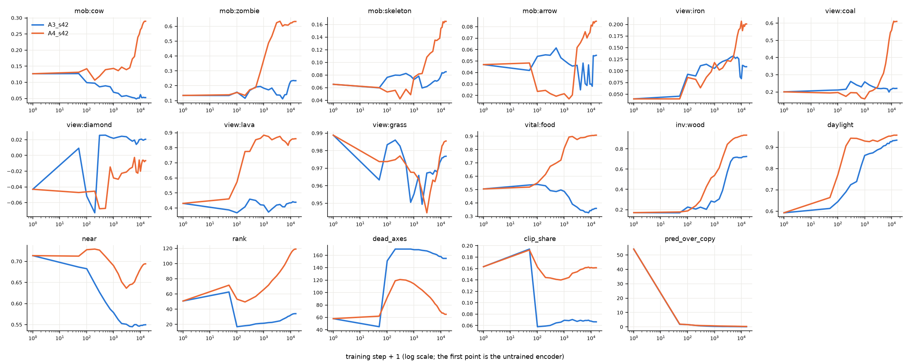

# MLP-JEPA on the state: what the latent holds over the training

Linear read (ridge, held-out episodes) of the latent at each check; `near`: the four tiles next to the player; `rank`: effective rank; `dead_axes`: principal axes under a tenth of the mean variance; `clip_share`: the variance inside a clip of 4 frames; `pred_over_copy`: the one-step error over copying the last latent. Step 0 is the untrained encoder.

- **A3_s42**: stop-grad False, latent 192, history 3, SIGReg 0.09, IDM 0.1, lr 0.001, 15551 steps (1.00 epochs), 24 checks
- **A4_s42**: stop-grad True, latent 192, history 3, SIGReg 0.09, IDM 0.1, lr 0.001, 15551 steps (1.00 epochs), 24 checks

| run | step | mob:cow | mob:zombie | mob:skeleton | mob:arrow | view:iron | view:coal | view:diamond | view:lava | view:grass | vital:food | inv:wood | daylight | near | rank | dead_axes | clip_share | pred_over_copy |
|---|---|---|---|---|---|---|---|---|---|---|---|---|---|---|---|---|---|---|
| A3_s42 | 0 | 0.13 | 0.14 | 0.07 | 0.05 | 0.04 | 0.20 | -0.04 | 0.43 | 0.99 | 0.50 | 0.17 | 0.59 | 0.71 | 51 | 58 | 0.16 | 54 |
| A3_s42 | 100 | 0.10 | 0.16 | 0.08 | 0.05 | 0.09 | 0.21 | -0.05 | 0.37 | 0.98 | 0.54 | 0.23 | 0.65 | 0.68 | 17 | 151 | 0.06 | 1.60 |
| A3_s42 | 500 | 0.09 | 0.19 | 0.08 | 0.06 | 0.11 | 0.24 | 0.03 | 0.45 | 0.97 | 0.49 | 0.20 | 0.74 | 0.60 | 21 | 170 | 0.06 | 0.57 |
| A3_s42 | 1000 | 0.07 | 0.18 | 0.07 | 0.05 | 0.11 | 0.26 | 0.02 | 0.42 | 0.96 | 0.49 | 0.28 | 0.86 | 0.58 | 22 | 169 | 0.07 | 0.36 |
| A3_s42 | 2000 | 0.06 | 0.18 | 0.06 | 0.05 | 0.12 | 0.23 | 0.02 | 0.39 | 0.95 | 0.39 | 0.39 | 0.87 | 0.55 | 23 | 168 | 0.07 | 0.27 |
| A3_s42 | 15551 | 0.05 | 0.23 | 0.09 | 0.06 | 0.11 | 0.22 | 0.02 | 0.44 | 0.98 | 0.36 | 0.72 | 0.93 | 0.55 | 34 | 155 | 0.07 | 0.13 |
| A4_s42 | 0 | 0.13 | 0.14 | 0.07 | 0.05 | 0.04 | 0.20 | -0.04 | 0.43 | 0.99 | 0.50 | 0.17 | 0.59 | 0.71 | 51 | 58 | 0.16 | 54 |
| A4_s42 | 100 | 0.14 | 0.15 | 0.05 | 0.02 | 0.09 | 0.20 | -0.05 | 0.57 | 0.97 | 0.55 | 0.19 | 0.77 | 0.73 | 53 | 92 | 0.16 | 1.56 |
| A4_s42 | 500 | 0.14 | 0.19 | 0.06 | 0.02 | 0.09 | 0.19 | -0.07 | 0.85 | 0.97 | 0.70 | 0.43 | 0.94 | 0.71 | 57 | 120 | 0.14 | 0.87 |
| A4_s42 | 1000 | 0.14 | 0.38 | 0.08 | 0.02 | 0.12 | 0.16 | -0.03 | 0.88 | 0.97 | 0.81 | 0.54 | 0.93 | 0.69 | 66 | 114 | 0.14 | 0.74 |
| A4_s42 | 2000 | 0.15 | 0.53 | 0.08 | 0.02 | 0.11 | 0.21 | -0.02 | 0.85 | 0.96 | 0.90 | 0.71 | 0.93 | 0.65 | 77 | 104 | 0.15 | 0.59 |
| A4_s42 | 15551 | 0.29 | 0.63 | 0.16 | 0.08 | 0.20 | 0.61 | -0.01 | 0.86 | 0.99 | 0.91 | 0.94 | 0.96 | 0.69 | 119 | 65 | 0.16 | 0.32 |

