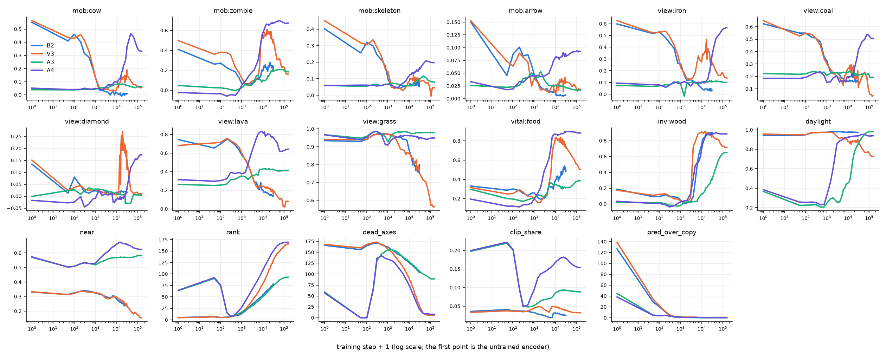

# What the latent holds over the first steps of the training

Linear read (ridge, held-out episodes) of the latent at each check; `near`: the four tiles next to the player; `rank`: effective rank; `dead_axes`: principal axes under a tenth of the mean variance; `clip_share`: the variance inside a clip of 4 frames; `pred_over_copy`: the one-step error over copying the last latent. Step 0 is the untrained encoder; steps are checkpoints, the epoch ends are the multiples of the steps per epoch.

- **B2** (seed42): encoder reads pixels, stop-grad False, history 3, SIGReg 0.09, 15551 steps per epoch, 41 checks, last step 31102
- **V3** (seed42): encoder reads pixels, stop-grad True, history 3, SIGReg 0.09, 15551 steps per epoch, 49 checks, last step 155510
- **A3** (seed42): encoder reads state, stop-grad False, history 3, SIGReg 0.09, 15551 steps per epoch, 49 checks, last step 155510
- **A4** (seed42): encoder reads state, stop-grad True, history 3, SIGReg 0.09, 15551 steps per epoch, 49 checks, last step 155510

| run | step | mob:cow | mob:zombie | mob:skeleton | mob:arrow | view:iron | view:coal | view:diamond | view:lava | view:grass | vital:food | inv:wood | daylight | near | rank | dead_axes | clip_share | pred_over_copy |
|---|---|---|---|---|---|---|---|---|---|---|---|---|---|---|---|---|---|---|
| B2 | 0 | 0.55 | 0.41 | 0.40 | 0.15 | 0.60 | 0.62 | 0.13 | 0.75 | 0.93 | 0.33 | 0.19 | 0.94 | 0.33 | 5.07 | 166 | 0.04 | 127 |
| B2 | 50 | 0.41 | 0.26 | 0.26 | 0.05 | 0.52 | 0.55 | 0.01 | 0.65 | 0.93 | 0.29 | 0.09 | 0.94 | 0.31 | 7.12 | 156 | 0.04 | 29 |
| B2 | 100 | 0.46 | 0.27 | 0.32 | 0.09 | 0.53 | 0.55 | 0.08 | 0.70 | 0.94 | 0.30 | 0.09 | 0.95 | 0.33 | 5.25 | 165 | 0.04 | 20 |
| B2 | 300 | 0.32 | 0.21 | 0.24 | 0.08 | 0.44 | 0.51 | 0.02 | 0.73 | 0.97 | 0.25 | 0.09 | 0.97 | 0.34 | 6.94 | 171 | 0.04 | 4.81 |
| B2 | 1000 | 0.14 | 0.07 | 0.10 | 0.05 | 0.26 | 0.33 | 0.02 | 0.58 | 0.97 | 0.26 | 0.05 | 0.98 | 0.32 | 13 | 162 | 0.03 | 1.36 |
| B2 | 2000 | 0.04 | 0.07 | 0.05 | 0.02 | 0.12 | 0.22 | 0.01 | 0.48 | 0.96 | 0.19 | 0.01 | 0.98 | 0.31 | 25 | 152 | 0.03 | 1.13 |
| B2 | 5000 | -0.00 | 0.11 | 0.05 | 0.01 | 0.10 | 0.19 | 0.01 | 0.29 | 0.94 | 0.33 | 0.29 | 0.98 | 0.29 | 42 | 139 | 0.02 | 0.94 |
| B2 | 15000 | 0.01 | 0.21 | 0.06 | 0.01 | 0.05 | 0.17 | 0.01 | 0.17 | 0.80 | 0.41 | 0.87 | 0.98 | 0.26 | 63 | 119 | 0.03 | 0.28 |
| B2 | 31102 | 0.01 | 0.23 | 0.05 | 0.01 | 0.03 | 0.16 | 0.02 | 0.14 | 0.80 | 0.49 | 0.90 | 0.97 | 0.24 | 78 | 104 | 0.02 | 0.27 |
| V3 | 0 | 0.56 | 0.50 | 0.45 | 0.15 | 0.63 | 0.65 | 0.15 | 0.68 | 0.94 | 0.31 | 0.17 | 0.96 | 0.33 | 4.66 | 168 | 0.03 | 139 |
| V3 | 50 | 0.44 | 0.36 | 0.32 | 0.07 | 0.52 | 0.53 | 0.02 | 0.71 | 0.94 | 0.25 | 0.11 | 0.95 | 0.31 | 6.52 | 160 | 0.04 | 34 |
| V3 | 100 | 0.43 | 0.38 | 0.31 | 0.06 | 0.53 | 0.55 | 0.04 | 0.72 | 0.94 | 0.25 | 0.12 | 0.95 | 0.32 | 5.07 | 168 | 0.04 | 22 |
| V3 | 300 | 0.42 | 0.35 | 0.29 | 0.08 | 0.49 | 0.51 | 0.03 | 0.73 | 0.97 | 0.27 | 0.10 | 0.97 | 0.34 | 6.66 | 173 | 0.03 | 5.50 |
| V3 | 1000 | 0.13 | 0.12 | 0.14 | 0.04 | 0.23 | 0.30 | 0.03 | 0.60 | 0.97 | 0.20 | 0.03 | 0.97 | 0.33 | 17 | 157 | 0.05 | 1.48 |
| V3 | 2000 | 0.04 | 0.05 | 0.04 | 0.02 | 0.13 | 0.23 | 0.02 | 0.48 | 0.96 | 0.16 | 0.02 | 0.97 | 0.32 | 30 | 143 | 0.05 | 1.17 |
| V3 | 5000 | 0.03 | 0.12 | 0.03 | 0.01 | 0.19 | 0.16 | 0.01 | 0.24 | 0.88 | 0.36 | 0.78 | 0.92 | 0.29 | 55 | 117 | 0.03 | 1.06 |
| V3 | 15000 | 0.10 | 0.58 | 0.09 | 0.03 | 0.37 | 0.26 | 0.06 | 0.24 | 0.84 | 0.82 | 0.91 | 0.86 | 0.28 | 96 | 70 | 0.04 | 0.62 |
| V3 | 155510 | 0.06 | 0.16 | 0.05 | 0.02 | 0.14 | 0.05 | 0.01 | 0.08 | 0.56 | 0.50 | 0.72 | 0.73 | 0.15 | 165 | 6 | 0.03 | 0.70 |
| A3 | 0 | 0.04 | 0.05 | 0.06 | 0.03 | 0.08 | 0.22 | -0.00 | 0.26 | 0.97 | 0.30 | 0.02 | 0.37 | 0.57 | 64 | 59 | 0.20 | 45 |
| A3 | 50 | 0.04 | 0.02 | 0.05 | 0.02 | 0.07 | 0.22 | 0.02 | 0.25 | 0.95 | 0.20 | 0.02 | 0.22 | 0.50 | 90 | 0 | 0.22 | 4.95 |
| A3 | 100 | 0.04 | 0.02 | 0.06 | 0.02 | 0.07 | 0.22 | 0.03 | 0.26 | 0.96 | 0.20 | 0.02 | 0.23 | 0.51 | 74 | 0 | 0.20 | 4.02 |
| A3 | 300 | 0.04 | 0.00 | 0.06 | 0.04 | 0.08 | 0.24 | 0.02 | 0.31 | 0.99 | 0.17 | -0.02 | 0.23 | 0.54 | 7.78 | 131 | 0.05 | 3.09 |
| A3 | 1000 | 0.04 | 0.02 | 0.07 | 0.04 | 0.09 | 0.21 | 0.03 | 0.35 | 0.93 | 0.20 | -0.02 | 0.25 | 0.52 | 17 | 155 | 0.05 | 1.05 |
| A3 | 2000 | 0.05 | 0.05 | 0.07 | 0.05 | 0.09 | 0.23 | 0.03 | 0.32 | 0.98 | 0.23 | 0.03 | 0.30 | 0.54 | 25 | 154 | 0.06 | 0.46 |
| A3 | 5000 | 0.07 | 0.15 | 0.06 | 0.03 | 0.10 | 0.23 | 0.02 | 0.38 | 0.98 | 0.34 | 0.03 | 0.31 | 0.56 | 38 | 140 | 0.07 | 0.27 |
| A3 | 15000 | 0.08 | 0.11 | 0.06 | 0.03 | 0.10 | 0.23 | 0.01 | 0.43 | 0.97 | 0.33 | 0.19 | 0.60 | 0.57 | 59 | 120 | 0.09 | 0.12 |
| A3 | 155510 | 0.06 | 0.18 | 0.08 | 0.02 | 0.10 | 0.19 | 0.00 | 0.41 | 0.98 | 0.39 | 0.65 | 0.98 | 0.58 | 93 | 89 | 0.09 | 0.06 |
| A4 | 0 | 0.05 | -0.02 | 0.06 | 0.03 | 0.09 | 0.19 | -0.02 | 0.32 | 0.97 | 0.19 | 0.03 | 0.38 | 0.57 | 64 | 57 | 0.20 | 38 |
| A4 | 50 | 0.04 | -0.04 | 0.06 | 0.02 | 0.08 | 0.18 | -0.03 | 0.30 | 0.94 | 0.12 | 0.01 | 0.26 | 0.50 | 92 | 0 | 0.22 | 4.45 |
| A4 | 100 | 0.04 | -0.04 | 0.06 | 0.02 | 0.08 | 0.19 | -0.02 | 0.30 | 0.95 | 0.12 | 0.01 | 0.25 | 0.51 | 75 | 0 | 0.20 | 3.76 |
| A4 | 300 | 0.05 | -0.05 | 0.06 | 0.03 | 0.08 | 0.23 | -0.04 | 0.39 | 0.99 | 0.14 | -0.04 | 0.25 | 0.53 | 7.30 | 136 | 0.05 | 3.20 |
| A4 | 1000 | 0.05 | 0.05 | 0.07 | 0.04 | 0.09 | 0.15 | -0.01 | 0.38 | 0.91 | 0.20 | 0.03 | 0.32 | 0.53 | 28 | 134 | 0.10 | 1.01 |
| A4 | 2000 | 0.03 | 0.13 | 0.05 | 0.04 | 0.10 | 0.19 | 0.00 | 0.48 | 0.95 | 0.32 | 0.04 | 0.61 | 0.58 | 51 | 127 | 0.14 | 0.60 |
| A4 | 5000 | 0.07 | 0.26 | 0.07 | 0.05 | 0.10 | 0.17 | 0.01 | 0.77 | 0.96 | 0.62 | 0.49 | 0.89 | 0.63 | 82 | 102 | 0.15 | 0.50 |
| A4 | 15000 | 0.13 | 0.67 | 0.13 | 0.08 | 0.11 | 0.21 | -0.01 | 0.79 | 0.96 | 0.87 | 0.85 | 0.93 | 0.67 | 124 | 55 | 0.18 | 0.35 |
| A4 | 155510 | 0.33 | 0.67 | 0.20 | 0.09 | 0.57 | 0.51 | 0.17 | 0.64 | 0.95 | 0.88 | 0.89 | 0.94 | 0.62 | 169 | 8 | 0.15 | 0.24 |

