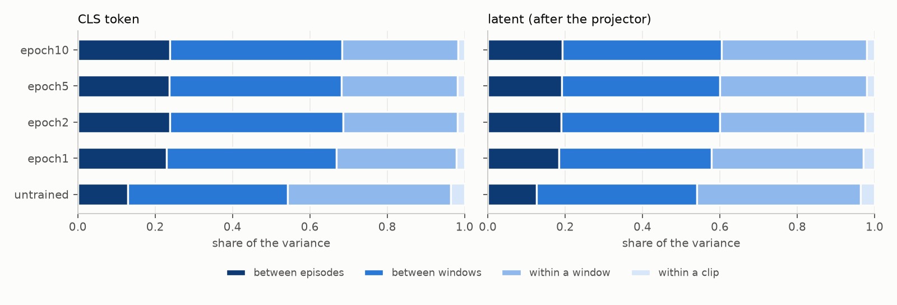
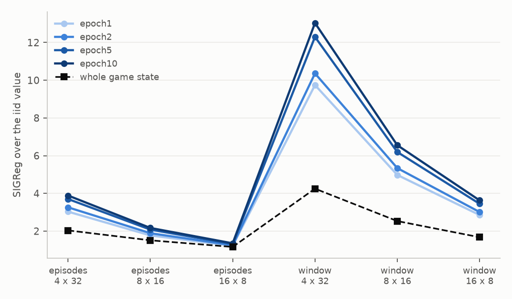
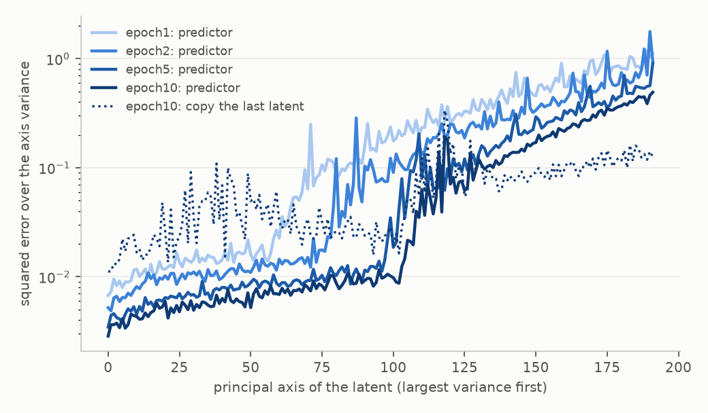
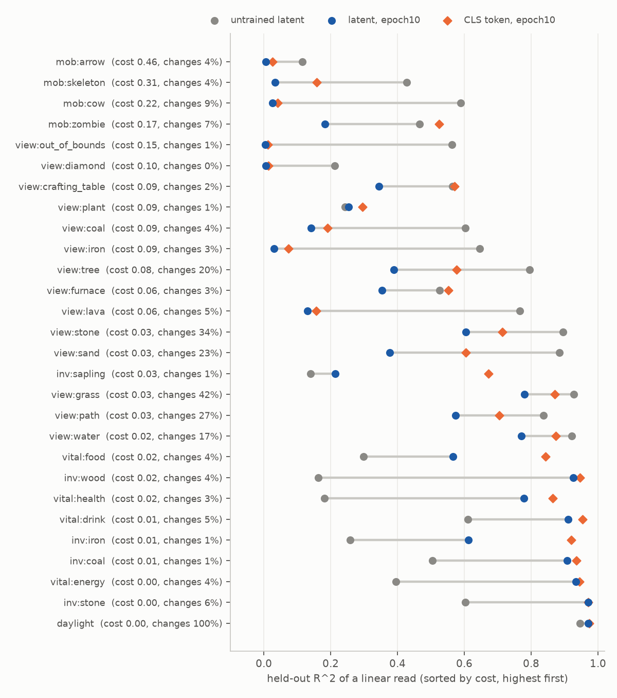

# Slowness analysis

Sample: 211 episodes x 4 windows x 64 frames of held-out worlds; the checkpoints: untrained, epoch1, epoch2, epoch5, epoch10.

## Reading (rule-based, thresholds are heuristics)

- Episode identity is not what the variance is made of: its share is 0.04 above the null (CLS 0.07, untrained -0.01; threshold 0.1).
- The variance is slow: 0.60 of it lies between windows or episodes and the lag-8 correlation is 0.85; the within-episode rank does not fall over training (62 to 101).
- Rank: effective rank 103 of 192 (healthy); 101 after centering per episode (the dimensions are not episode-specific).
- SIGReg of windows of 8 episodes is 6.6x the iid value; the whole state would give 2.5x. The latent is slower than the whole state (ratio of ratios 2.59, threshold 1.5).
- 9 factors are lost against the untrained latent (linear R^2 below 0.5 of it): expensive to predict (cost >= 0.15): mob:zombie, mob:cow, mob:skeleton; rare (changes in under 5% of the steps): view:out_of_bounds, view:coal, view:iron, view:lava; neither: view:tree, view:sand.
- The predictor's one-step error is 0.007 of the variance and 0.99 of the variance lies on free axes: the prediction loss exerts little pressure on this latent (the selection happened earlier).
- From the game state, the group `slow` alone explains 0.29 of the latent's variance (all groups: 0.41; held-out episodes, MLP).

## Variance by time scale (share of the total)

| | episode (null) | window | within a window | within a clip | effective rank | rank in an episode | lag 8 |
|---|---|---|---|---|---|---|---|
| latent/untrained | 0.126 (0.13) | 0.414 | 0.424 | 0.036 | 5.3 | 5.3 | 0.73 |
| cls/untrained | 0.129 (0.13) | 0.414 | 0.422 | 0.035 | 4.6 | 4.6 | 0.74 |
| latent/epoch1 | 0.184 (0.15) | 0.395 | 0.393 | 0.029 | 62.8 | 62.0 | 0.83 |
| cls/epoch1 | 0.229 (0.17) | 0.439 | 0.311 | 0.021 | 30.3 | 30.4 | 0.88 |
| latent/epoch2 | 0.190 (0.15) | 0.409 | 0.376 | 0.025 | 76.7 | 76.0 | 0.84 |
| cls/epoch2 | 0.238 (0.17) | 0.449 | 0.294 | 0.019 | 37.1 | 37.5 | 0.89 |
| latent/epoch5 | 0.191 (0.15) | 0.410 | 0.379 | 0.021 | 96.3 | 94.7 | 0.85 |
| cls/epoch5 | 0.236 (0.17) | 0.445 | 0.300 | 0.018 | 50.2 | 50.4 | 0.89 |
| latent/epoch10 | 0.193 (0.15) | 0.411 | 0.376 | 0.020 | 102.7 | 100.9 | 0.85 |
| cls/epoch10 | 0.238 (0.17) | 0.445 | 0.301 | 0.016 | 55.0 | 55.3 | 0.89 |

## SIGReg by batch composition (latent, raw / centered)

| | iid 4x32 | iid 8x16 | iid 16x8 | episodes 4x32 | episodes 8x16 | episodes 16x8 | window 4x32 | window 8x16 | window 16x8 |
|---|---|---|---|---|---|---|---|---|---|
| whole state | 3.38 / 2.97 | 3.38 / 2.82 | 3.38 / 2.58 | 6.88 / 5.98 | 5.10 / 5.49 | 3.92 / 4.43 | 14.36 / 16.18 | 8.55 / 14.31 | 5.66 / 13.94 |
| untrained | 53.02 / 49.82 | 53.02 / 49.82 | 53.02 / 49.82 | 53.03 / 49.95 | 53.03 / 49.94 | 53.03 / 49.89 | 53.28 / 50.67 | 53.17 / 50.68 | 53.06 / 50.67 |
| epoch1 | 1.76 / 1.06 | 1.76 / 1.05 | 1.76 / 1.05 | 5.32 / 2.46 | 3.11 / 1.69 | 2.14 / 1.28 | 17.11 / 13.54 | 8.74 / 11.92 | 5.01 / 11.77 |
| epoch2 | 1.70 / 0.93 | 1.70 / 0.93 | 1.70 / 0.93 | 5.55 / 2.46 | 3.22 / 1.64 | 2.13 / 1.19 | 17.65 / 14.65 | 9.10 / 12.95 | 5.13 / 12.65 |
| epoch5 | 1.43 / 0.83 | 1.43 / 0.83 | 1.43 / 0.83 | 5.29 / 2.33 | 2.97 / 1.52 | 1.88 / 1.07 | 17.60 / 14.92 | 8.86 / 12.85 | 4.93 / 12.62 |
| epoch10 | 1.36 / 0.79 | 1.36 / 0.79 | 1.36 / 0.80 | 5.28 / 2.33 | 2.94 / 1.51 | 1.83 / 1.05 | 17.70 / 15.15 | 8.90 / 13.01 | 4.93 / 12.84 |

## R^2 of the latent from groups of game factors (held-out episodes, MLP)

| | all | slow | medium | facing | view | near (alone) | residual episode share (null) |
|---|---|---|---|---|---|---|---|
| latent/untrained | 0.84 | 0.21 | 0.23 | -0.00 | 0.25 | 0.13 | 0.10 (0.08) |
| cls/untrained | 0.89 | 0.25 | 0.25 | -0.00 | 0.27 | 0.13 | 0.09 (0.09) |
| latent/epoch1 | 0.54 | 0.31 | 0.10 | 0.03 | 0.03 | 0.00 | 0.12 (0.10) |
| cls/epoch1 | 0.75 | 0.52 | 0.19 | 0.02 | 0.07 | 0.03 | 0.12 (0.10) |
| latent/epoch2 | 0.52 | 0.33 | 0.09 | 0.02 | 0.01 | -0.01 | 0.14 (0.11) |
| cls/epoch2 | 0.75 | 0.54 | 0.18 | 0.01 | 0.06 | 0.02 | 0.14 (0.11) |
| latent/epoch5 | 0.44 | 0.30 | 0.07 | 0.01 | -0.00 | -0.01 | 0.15 (0.12) |
| cls/epoch5 | 0.69 | 0.51 | 0.15 | 0.01 | 0.04 | 0.01 | 0.15 (0.12) |
| latent/epoch10 | 0.41 | 0.29 | 0.06 | 0.01 | -0.01 | -0.02 | 0.15 (0.12) |
| cls/epoch10 | 0.66 | 0.51 | 0.13 | 0.01 | 0.03 | 0.00 | 0.15 (0.12) |

## Predictor error (one step, teacher-forced)

| | error / variance | error / copy error | variance on free axes |
|---|---|---|---|
| epoch1 | 0.0152 | 0.286 | 0.984 |
| epoch2 | 0.0118 | 0.268 | 0.989 |
| epoch5 | 0.0084 | 0.240 | 0.992 |
| epoch10 | 0.0069 | 0.209 | 0.995 |

