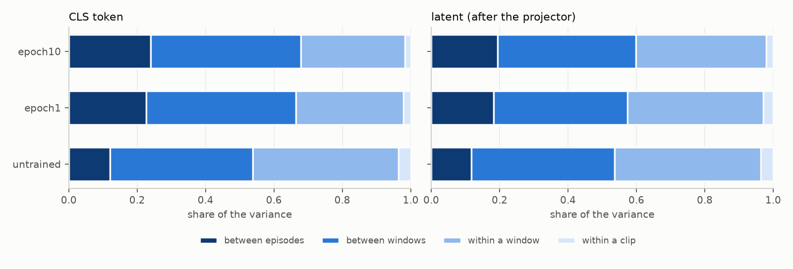
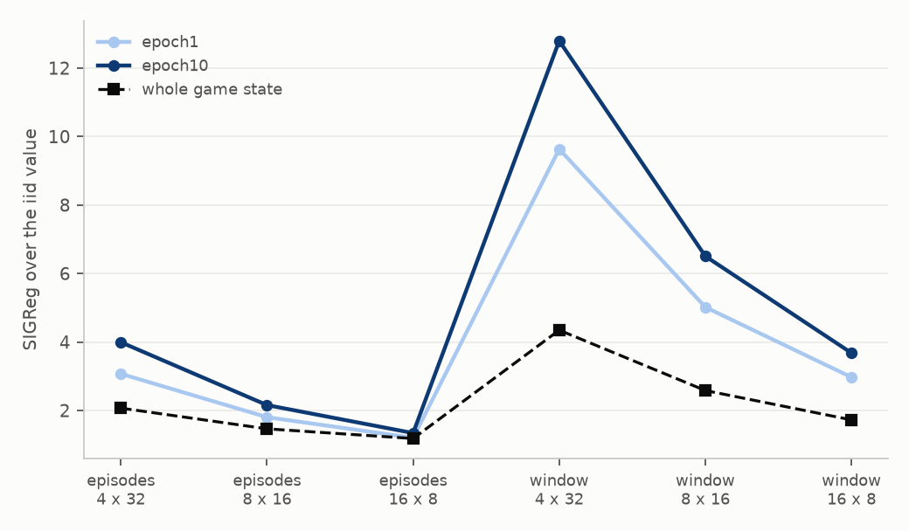
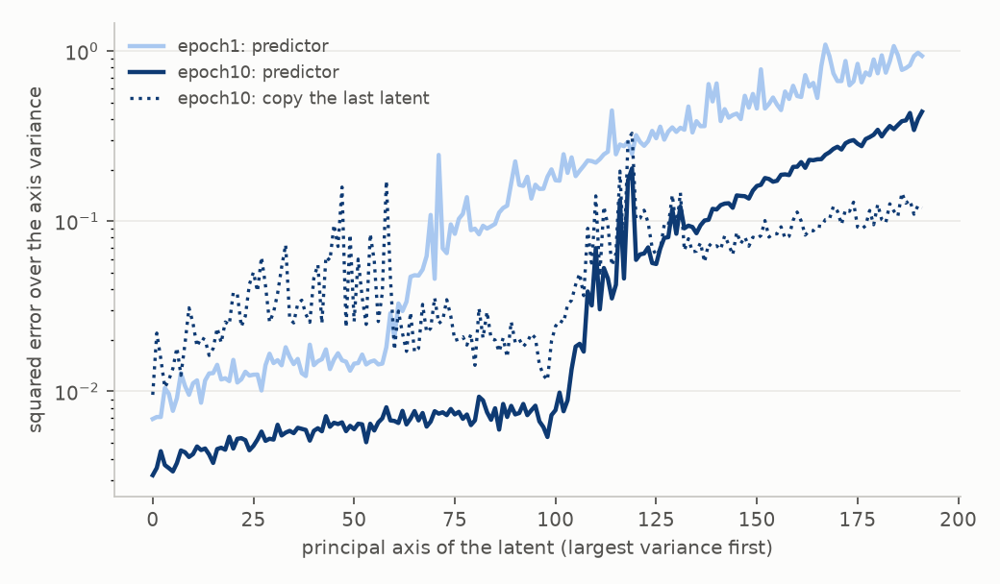
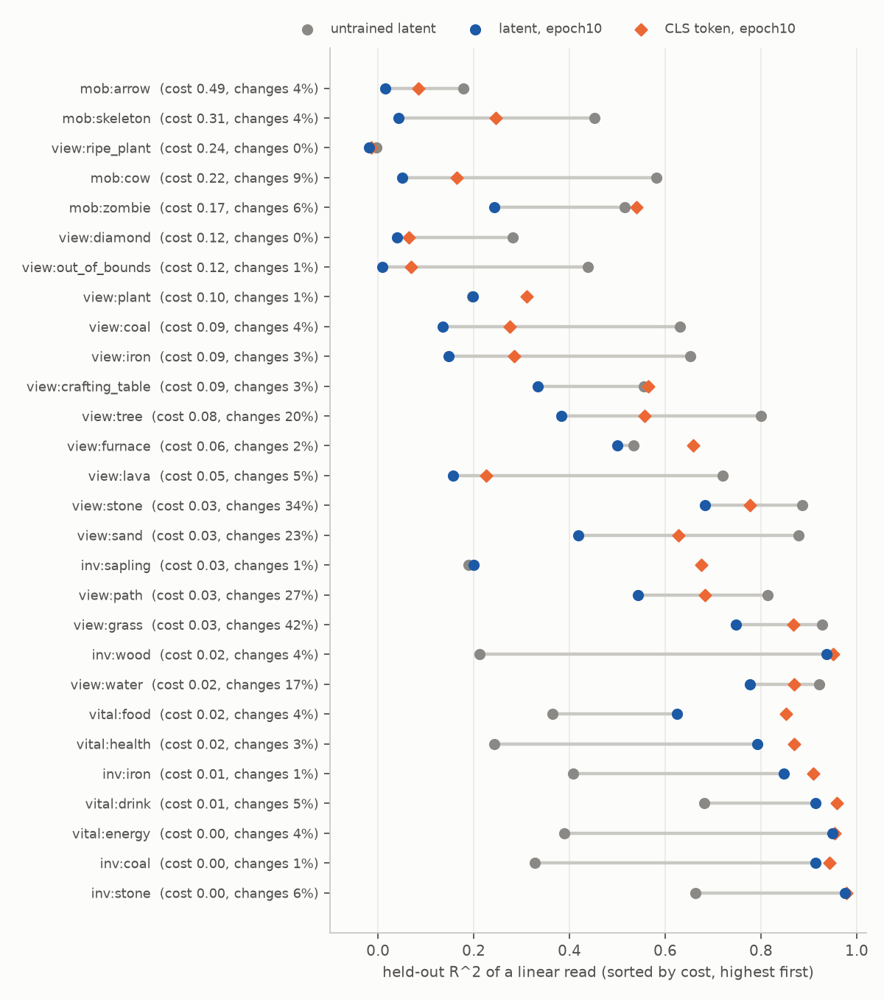

# Slowness analysis

Sample: 800 episodes x 4 windows x 64 frames of held-out worlds; the checkpoints: untrained, epoch1, epoch10.

## Reading (rule-based, thresholds are heuristics)

- Episode identity is not what the variance is made of: its share is 0.04 above the null (CLS 0.07, untrained -0.02; threshold 0.1).
- The variance is slow: 0.60 of it lies between windows or episodes and the lag-8 correlation is 0.85; the within-episode rank does not fall over training (63 to 104).
- Rank: effective rank 106 of 192 (healthy); 104 after centering per episode (the dimensions are not episode-specific).
- SIGReg of windows of 8 episodes is 6.5x the iid value; the whole state would give 2.6x. The latent is slower than the whole state (ratio of ratios 2.52, threshold 1.5).
- 9 factors are lost against the untrained latent (linear R^2 below 0.5 of it): expensive to predict (cost >= 0.15): mob:zombie, mob:cow, mob:skeleton; rare (changes in under 5% of the steps): view:out_of_bounds, view:coal, view:iron, view:lava; neither: view:tree, view:sand.
- The predictor's one-step error is 0.007 of the variance and 1.00 of the variance lies on free axes: the prediction loss exerts little pressure on this latent (the selection happened earlier).
- From the game state, the group `slow` alone explains 0.44 of the latent's variance (all groups: 0.53; held-out episodes, MLP).

## Variance by time scale (share of the total)

| | episode (null) | window | within a window | within a clip | effective rank | rank in an episode | lag 8 |
|---|---|---|---|---|---|---|---|
| latent/untrained | 0.118 (0.14) | 0.418 | 0.428 | 0.037 | 5.2 | 5.2 | 0.74 |
| cls/untrained | 0.120 (0.14) | 0.418 | 0.426 | 0.036 | 4.6 | 4.5 | 0.74 |
| latent/epoch1 | 0.183 (0.14) | 0.391 | 0.397 | 0.029 | 63.9 | 63.0 | 0.83 |
| cls/epoch1 | 0.226 (0.17) | 0.439 | 0.314 | 0.021 | 30.5 | 30.6 | 0.88 |
| latent/epoch10 | 0.193 (0.15) | 0.405 | 0.381 | 0.020 | 105.6 | 103.6 | 0.85 |
| cls/epoch10 | 0.239 (0.17) | 0.440 | 0.304 | 0.017 | 55.8 | 56.1 | 0.89 |

## SIGReg by batch composition (latent, raw / centered)

| | iid 4x32 | iid 8x16 | iid 16x8 | episodes 4x32 | episodes 8x16 | episodes 16x8 | window 4x32 | window 8x16 | window 16x8 |
|---|---|---|---|---|---|---|---|---|---|
| whole state | 3.51 / 3.08 | 3.51 / 2.93 | 3.51 / 2.69 | 7.26 / 6.23 | 5.14 / 5.43 | 4.14 / 4.61 | 15.26 / 16.86 | 9.06 / 15.39 | 6.05 / 14.59 |
| untrained | 53.06 / 49.84 | 53.06 / 49.84 | 53.06 / 49.83 | 53.14 / 50.00 | 53.10 / 49.96 | 53.08 / 49.90 | 53.48 / 50.67 | 53.31 / 50.71 | 53.10 / 50.66 |
| epoch1 | 1.73 / 1.06 | 1.73 / 1.05 | 1.73 / 1.05 | 5.33 / 2.50 | 3.13 / 1.70 | 2.08 / 1.28 | 16.71 / 12.58 | 8.70 / 11.82 | 5.15 / 11.86 |
| epoch10 | 1.36 / 0.79 | 1.36 / 0.79 | 1.36 / 0.79 | 5.44 / 2.39 | 2.94 / 1.52 | 1.83 / 1.05 | 17.44 / 14.08 | 8.86 / 13.01 | 5.01 / 13.06 |

## R^2 of the latent from groups of game factors (held-out episodes, MLP)

| | all | slow | medium | facing | view | near | layout (alone) | residual episode share (null) |
|---|---|---|---|---|---|---|---|---|
| latent/untrained | 0.92 | 0.28 | 0.27 | -0.00 | 0.28 | 0.18 | 0.05 | 0.08 (0.08) |
| cls/untrained | 0.94 | 0.29 | 0.28 | -0.00 | 0.29 | 0.18 | 0.06 | 0.08 (0.08) |
| latent/epoch1 | 0.63 | 0.42 | 0.13 | 0.03 | 0.05 | 0.02 | -0.09 | 0.10 (0.09) |
| cls/epoch1 | 0.83 | 0.62 | 0.23 | 0.02 | 0.09 | 0.06 | -0.11 | 0.11 (0.09) |
| latent/epoch10 | 0.53 | 0.44 | 0.09 | 0.01 | 0.02 | 0.01 | -0.10 | 0.13 (0.11) |
| cls/epoch10 | 0.75 | 0.63 | 0.17 | 0.01 | 0.05 | 0.02 | -0.14 | 0.14 (0.11) |

## Predictor error (one step, teacher-forced)

| | error / variance | error / copy error | variance on free axes |
|---|---|---|---|
| epoch1 | 0.0151 | 0.282 | 0.987 |
| epoch10 | 0.0066 | 0.198 | 0.995 |

